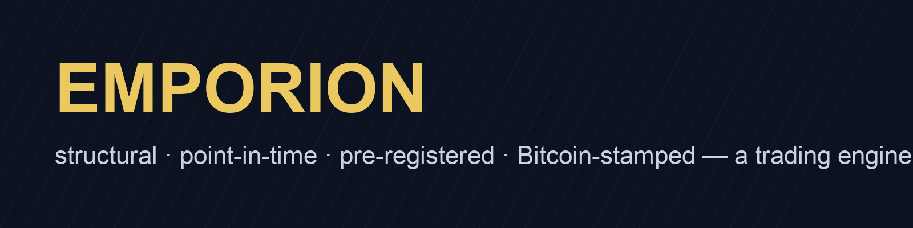

<h3 align="center">EMPORION · Honest Trading Engine</h3>

<em>Developed by Deepak Soni — AI Architect</em>

# Emporion — a structural deep-learning trading engine with a falsifiable record

**A market-clearing model of stock prices (beliefs × risk tolerance × supply, solved exactly), a general-equilibrium
prior from the sibling [Agora](https://huggingface.co/deepakdsoni/agora-cge-models) economy model, and — the part that
is unusual — an honesty stack that every number must pass before it may recommend a trade, ending in a public,
Bitcoin-stamped record of every signal the engine publishes, one file per market per day.**

This repository is the model card and documentation home of Emporion. **No trained weights are published yet**:
three deep-model architectures were built and evaluated, and none beat its own anchors on the pre-declared exit line
(Section 6). That result is on the ledger and in this card. Weights will be uploaded the day a model earns its place —
not before. What *is* live is the pre-registered signal chain (Section 7), which is the product until then.

> **Audience note.** Sections 1–5 give the model, the estimator and the certification mathematics for a quantitative
> reader. Section 6 gives measured results — mostly negative, all ledgered. Section 7 is the live record. Section 9
> states limitations. **If you just want to know what it does for you, read the next section first.**

---

## What it does — in plain terms

Emporion answers one question honestly: *"of the stocks I can actually trade today, which should I own for the next
month, and how sure can anyone be?"* — for US large caps, the Indian NSE, and the major crypto pairs.

It differs from a backtest in three ways you can check yourself:

1. **Every input is what was knowable that evening.** Universes are chosen by the past year's traded value, not by
   today's index; every fundamental is the version that had been filed by the decision date, restatements arrive
   when they were filed; institutional holdings are the batch that existed, not the amended one.
2. **Every signal is counted against everything that was tried.** The deflated Sharpe hurdle uses the number of
   distinct procedures on an append-only ledger; a rerun is not a new trial, a code change is. The probability of
   backtest overfitting is computed across the whole ladder of ideas, so adding ideas makes the bar higher, not lower.
3. **Every recommendation is published before the price exists.** One file per market per night, hashed, chained to
   the previous file, and stamped into Bitcoin through OpenTimestamps. Anyone can run `ots verify` on any file.

### What you get from it today

| You want… | It gives you… |
|---|---|
| A US large-cap book, monthly rebalanced | the **accruals** top-quintile and the **no-fit composite** (value, earnings surprise, accruals, momentum, equal z-weights, fixed forever) — pre-registered 2026-09-06 |
| An NSE book | the **earnings-surprise** top-quintile within the point-in-time top-200 — pre-registered 2026-09-07 |
| A same-day sector call on a tariff action | the **event rotation** book: long/short quartile of sector ETFs from Agora's producer-price response, stamped before the open |
| To know whether to trust any of it | the **live record page** rebuilt nightly from the chain alone: books, abstentions, proof status, realised returns |
| The negative results | Section 6 and `docs/EMPORION-FINDINGS.md` — what was tried and what did not survive |

---

## 1–5. The mathematics (summary; the full derivations are in [`MATHEMATICS.md`](MATHEMATICS.md))

**Clearing.** CARA investors with beliefs $\mu$, covariance $\Sigma$, aggregate risk tolerance $A=\sum_k a_k^{-1}$, a
mandated sector holding a fraction $\varphi$ of supply $s$; demand $x_k = a_k^{-1}\Sigma^{-1}(\mu - R_f p)$; equilibrium

$$\hat p = R_f^{-1}\big(\mu - \kappa\,\Sigma s\big),\qquad \kappa = \frac{1-\varphi}{A},\qquad \text{signal } -r_{\text{mkt}} = \log(\hat p/p).$$

With leverage caps and extrapolative retail the equilibrium is the Gauss–Newton zero of Scarf's excess demand.

**Kernel.** $M = e^{-q^\top D/A}/\mathbb{E}[e^{-q^\top D/A}]$, $q=(1-\varphi)s$, normaliser
$\exp(w^\top\mu + \tfrac12 w^\top\Sigma w)$ analytic; projected onto $\mathbb{E}[M]=1/R_f$; prices the clearing
equilibrium exactly.

**Identification.** $R_f p = \mu - \kappa\Sigma s$ identifies $(\mu,\kappa)$ only up to the anchor on $\mu$;
$(A,\varphi)$ only through $\kappa$. Hence $\kappa$ is seeded by the panel estimator $\hat\kappa = \pi^\top x/x^\top x$
($\pi$ = realised excess payoffs, $x=\Sigma s$), the law is imposed at $\hat p$ (at $p$ it inverts the signal:
$-0.50$ vs $+0.95$ correlation with true mispricing), and beliefs come from external anchors.

**Anchors.** Value $\log\big((e_i/\bar y)/p_i\big)$ with $\bar y$ the median earnings yield; SUE = seasonal EPS difference
over its 8-quarter std; accruals from XBRL balance-sheet changes; eight replication-study price themes; the
pre-registered composite $\tfrac14\sum z(\cdot)$ with fixed weights; 13F breadth and level under the fullest-batch rule.

**General-equilibrium prior.** Agora's open-economy CGE (Leontief–CES KLEM, Armington $\sigma_q$, CET $\omega_t$, LES
households, ICIO-45) solved by Newton with homotopy to residual $\le 10^{-9}$ for each dated tariff action; the
producer-price response $\Delta\log PX$ mapped to ETFs by an exposure table (and to stocks by a validated industry map).

**Deep model.** Fourier features → set Transformer (permutation-equivariant, key-padding mask) → belief corrections
$\delta_i$ and state $(a,\varphi)$ → exact clearing → loss = law residual at $\hat p$ + LogSumExp tail + penalties on
$\delta$ and on $\mu-$anchor, residual-adaptive resampling, validation early stopping. v2: ridge / gradient boosting /
MLP over the anchors with a within-date rank target.

**Honesty stack.** Deflated Sharpe with $\text{SR}_0$ from the expected maximum of $N$ distinct procedures (leave-one-out
robust variance; $N$ from ledger procedure hashes), PBO by CSCV over 16 blocks across the whole rung family,
stationary-bootstrap CI vs the equal-weight point-in-time universe, permutation null, CPCV $\binom{6}{2}$ purged and
embargoed, point-in-time universes and feature coverage, and pre-registration with a SHA-256 hash chain anchored in
Bitcoin by OpenTimestamps. Formulas and the validator-validation tests: `MATHEMATICS.md` §10.

## 6. Measured results (all on the ledger; scopes in `docs/EMPORION-FINDINGS.md`)

| question | answer |
|---|---|
| Does the structural model find mispricing when the anchor is informative? | Yes: 0.95 out-of-sample correlation with true mispricing on synthetic markets; identities and validators hold |
| Does v0/v1 beat its anchor on real data? | **No** — equal to the value anchor to the third decimal on US (430+ dates, CPCV), NSE, pooled, with and without pre-training |
| Does a network over the anchors beat equal weights (v2)? | **No** — US +0.016–0.020 vs composite +0.030 (h20); NSE, after a coverage leak was removed, +0.02–0.03 vs +0.045 |
| Which anchors rank stocks? | US accruals +0.019/+0.023 rank-IC (t 2.1/2.6), composite +0.032 (t 2.1); NSE earnings surprise +0.035/+0.036 (t 3.1/4.1) |
| Is anything certified? | **Nothing yet.** US candidates fail only PBO across the ladder (0.21–0.24 vs 0.20); NSE SUE fails only beats-EW. Hence the live chain |
| Does Agora's prior price anything? | Sector ETFs on the event day: rank-IC +0.125 (t 2.3, permutation p 0.003, n = 20), robust to dropping the metal ETFs; **not** individual stocks (+0.018, t 0.6) |
| Are holdings a signal? | Level and change: no. Breadth of ownership change: +0.036 (t 2.2) at 60 days, on the watch list |
| Is a nowcast of holdings between filings informative? | No — a Kalman filter with Z.1 drift or trailing returns equals carry-forward |
| Kronos zero-shot as an encoder? Regime gating? | Both rejected: rank-IC ≤ random; stress regimes carried the rebounds |

Three data defects were found by sanity checks on levels, not by statistics, each with a written rule and a test:
undeclared XBRL base contexts in old NSE filings (year-to-date read as quarters), NSE percentages arriving as
fractions from Sep-2025, and SEC 13F datasets carrying late filings for earlier quarters. A fourth — feature coverage
that was not point-in-time — was found by reading model coefficients after cross-validation had passed it.

## 7. The live record

Nightly on GitHub Actions (no server, no GPU): refresh point-in-time data, build the pre-registered files, hash, chain,
stamp, verify, rebuild the record page, store state. Day 1 = 2026-09-06 (attested in Bitcoin blocks 965744/965751).
Files carry the strategy text, universe rule, every score, and the target weights; a missing night is recorded as a gap,
never back-filled. Certification of a 20-day signal needs roughly 6–12 months of prints; until then the page is a
record, not a claim.

## 8. What is in this repository

- `README.md` — this card; `MATHEMATICS.md` — every equation, estimator and test. `docs/` — the research notes 01–12 (models, state of the art, evaluation and overfitting with
  the data rules, the unique design, the practical guide, real-time training, the trader-facing design, the review
  response, identification, direction review, stock transfer, pooled result), the findings document, the status
  reports, and the pre-registration rule for events.
- **Weights: none yet.** Emporion v0/v1/v2 checkpoints exist but did not pass their exit lines; publishing them would
  imply a claim the ledger does not support. The first model that beats its anchor out of sample on the pre-declared
  line will be uploaded here with its ledger scope and CPCV record.
- The engine code, tests (56) and the nightly runner live in the private GitHub repository; the point-in-time stores
  and the chain state live in a private dataset. Ask for access.

## 9. Limitations, honestly

- Nothing is certified. The two US rules and the NSE rule are pre-registered candidates whose live record is days old.
- Survivorship: the US pool is today's top-1000 by traded value; the bias was measured on a 13F-implied survivorship-free
  quarterly panel at ≈ 0.00–0.02 rank-IC for momentum-type anchors, and not measured for the fundamental anchors.
- NSE fundamentals begin in 2018 and shareholding in Sep-2021; NSE price history begins in 2022.
- The sector map from industries to ISIC codes is hand-built (validated at rank-correlation 0.7 against real ETFs).
- The general-equilibrium prior has twenty events; the day-0 effect is significant, the tradeable-window effect is not.
- Costs are a flat 10–15 bp; no market-impact model; books are equal-weight top quintiles, not optimised portfolios.
- Crypto is rankable by risk but nothing beats equal weight after costs.

## 10. Markets — now and next

| market | status | data (all point-in-time) |
|---|---|---|
| **US** large caps (top-1000 pool, PIT top-200/500) | live: 2 pre-registered files | Nasdaq bars, SEC XBRL, 13F, Fed Z.1, consensus snapshots |
| **India / NSE** (PIT top-200 of the full cash market) | live: 1 pre-registered file | NSE bhavcopy, Ind-AS XBRL (legacy + Integrated Filing), shareholding, FII/DII flows |
| **Crypto** (Coinbase, PIT top-100) | research track file | Coinbase candles, CoinGecko supply |
| **Europe (Euronext, Nasdaq Nordic, Borsa Italiana, BME, Oslo, Vienna) and UK (LSE)** | **data built 2026-09-08; first-pass ladder run, nothing certified or pre-registered** (`docs/PHASE-EU-UK.md`) | fundamentals: ESEF/UKSEF XBRL via filings.xbrl.org (keyless, FY2020→, 12 countries, 2,972 issuers; Germany/Ireland not mirrored); prices: Yahoo daily bars (research source only) for 2,018 issuers since 2016; STOXX 600 sector ETFs for the Agora event harness. First pass: value ranks stocks (+0.08 rank-IC, t 2.9 at 60 d, 52 dates, fails PBO); accruals flips sign vs the US; 9 EU trade events show no day-0 effect |

The engine is market-agnostic by construction (a market = a bars store + optional filings stores + a universe rule);
adding a market is a loader, a universe rule, and the same honesty stack. The order of work is Europe/UK next, then
Japan if a point-in-time filings source exists.

## 11. Roadmap

Measured beliefs from the accumulating consensus-revision history as an anchor the price cannot see; actual ETF
constituents for the sector map; twenty stamped live events for the harness; the write-up after the first six
months of prints. A deep model returns to this card only when it passes its exit line.

---

*Emporion is a personal, open research project. Not investment advice. Research-only licence.*
